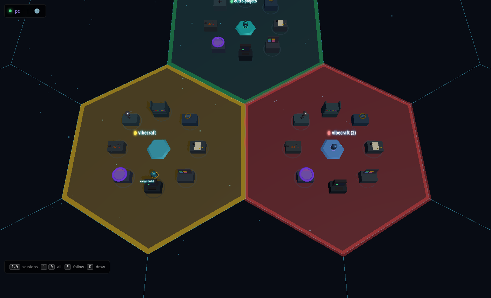

# Vibecraft



A 3D status monitor for the Claude Code sessions running in your terminals.

Each session gets a hexagonal zone named after its directory, with a robot
that walks to a workstation for every tool Claude uses (bookshelf for Read,
terminal for Bash, desk for Write...). A light next to the name tells you at a
glance what each session needs:

| Light | Meaning | When |
|---|---|---|
| 🟢 Green | Free | Claude finished, or is waiting for your next prompt |
| 🟡 Yellow | Busy | Processing a prompt or running tools |
| 🔴 Red | Needs you | A permission prompt, a dialog, or a question from Claude (pulses until answered) |

Several sessions in the same directory are told apart as `name`, `name (2)`,
`name (3)`... Zones disappear when their session ends.

Everything stays on your machine: a Claude Code hook records events, a local
server streams them to the page, and nothing is sent anywhere else.

## Requirements

- Linux (macOS should work but is untested)
- [Rust](https://rustup.rs) to build the hook and the server
- Node.js only to build the frontend and run the tests

## Setup

```bash
npm install && npm run build                    # frontend (dist/) + Rust binaries
rust/target/release/vibecraft-server setup      # install the hook into ~/.claude/settings.json
rust/target/release/vibecraft-server            # start the server
```

Open http://localhost:4003 and use Claude Code in your terminals as usual.
Sessions already running pick up the hook after a restart.

`vibecraft-server uninstall` removes the hook (your data in `~/.vibecraft/data` is kept).

## Keyboard

| Key | Action |
|---|---|
| `1`-`9` | Focus a zone |
| `0` / `` ` `` | Overview of all zones |
| `F` | Follow the active session |
| `P` | Station panels (last tools per workstation) |
| `D` | Draw mode: paint the floor (`1-6` colors, `0` eraser, `Q/E` brush, `R` 3D stack, `X` clear) |
| `Alt+D` | Animation test panel |

Click a zone to focus it, right-click it to dismiss it, and click the floor to
add a text label.

## Configuration

Environment variables of `vibecraft-server`, all optional:

| Variable | Default | |
|---|---|---|
| `VIBECRAFT_PORT` | 4003 | HTTP and WebSocket port |
| `VIBECRAFT_HOST` | 127.0.0.1 | Bind address (keep it local: events carry your prompts) |
| `VIBECRAFT_EVENTS_FILE` | `~/.vibecraft/data/events.jsonl` | Event log written by the hook |
| `VIBECRAFT_TILES_FILE` | `~/.vibecraft/data/tiles.json` | Floor text labels |
| `VIBECRAFT_MAX_EVENTS` | 1000 | Events kept in memory |
| `VIBECRAFT_DIST_DIR` | `dist/` next to the repo | Built frontend |

## Development

```bash
npm run dev       # frontend with hot reload on :4002 (proxies to the server on :4003)
npm test          # build, Rust tests, then the contract tests
npm run bench     # hook latency and server throughput
```

See [CLAUDE.md](CLAUDE.md) for the architecture and
[docs/RUST_MIGRATION.md](docs/RUST_MIGRATION.md) for how this fork got here.

## Credits

Fork of [vibecraft](https://github.com/nearcyan/vibecraft) by nearcyan.

## License

MIT
